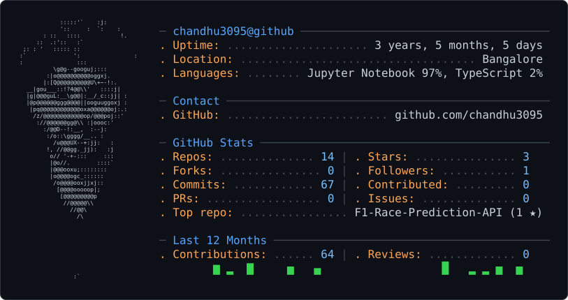

 

  <picture>
    <source media="(prefers-color-scheme: dark)" srcset="dark_mode.svg" />
    <source media="(prefers-color-scheme: light)" srcset="light_mode.svg" />
    
  </picture>

  # Hi, I'm Chandrasekhar Mangali 👋

  ### Aspiring AI/ML Engineer | Data Science | Generative AI

  *Building practical AI solutions, predictive models, and intelligent applications.*

  
  
  

---

## 👨‍💻 About Me

I'm an Artificial Intelligence and Data Science graduate interested in building practical solutions using machine learning, data analytics, and generative AI.

- 🤖 Exploring machine learning, predictive modeling, and AI engineering.
- 📊 Working with data analysis, feature engineering, and visualization.
- 🧠 Learning to build RAG applications and AI agents.
- 🚀 Developing end-to-end ML applications and exploring deployment with FastAPI.
- 🎯 Seeking opportunities in Data Analytics, Data Science, Machine Learning, and AI Engineering.

## 🛠️ Tech Stack

**Languages & Data**

**Machine Learning & Analytics**

**Generative AI & Backend**

**Tools & Workflow**

## 🚀 Featured Projects

### 🏎️ Formula 1 Race Outcome Prediction

Machine learning project focused on predicting race finishing positions through feature engineering, XGBoost, model explainability, and visualization.

**Tech:** Python · SQL · XGBoost · SHAP · Power BI

[**View Repository →**](https://github.com/chandhu3095/Formula-1-Race-Outcome-Prediction)

### 📈 Bank Marketing Term Deposit Prediction

Classification project focused on predicting customer term-deposit subscriptions using data preprocessing, feature engineering, predictive modeling, and evaluation.

**Tech:** Python · Pandas · NumPy · Scikit-learn · Machine Learning

[**View Repository →**](https://github.com/chandhu3095/Bank-Marketing-Term-Deposit-Prediction-ML)

## 🎯 Current Focus

- Building end-to-end machine learning projects.
- Developing retrieval-augmented generation (RAG) applications.
- Exploring AI agents and LangGraph workflows.
- Learning to serve ML models with FastAPI.
- Strengthening SQL, analytics, and model evaluation skills.

## 💼 Career Interests

Data Analyst · Data Scientist · Machine Learning Engineer · AI Engineer · Generative AI Engineer

## 🤝 Let's Connect

I'm open to connecting with engineers, data professionals, recruiters, and teams working on AI, machine learning, and analytics.

- **LinkedIn:** [Chandrasekhar Mangali](https://www.linkedin.com/in/chandrasekharmangali)
- **Email:** [chandrasekharchandhu97@gmail.com](mailto:chandrasekharchandhu97@gmail.com)
- **GitHub:** [@chandhu3095](https://github.com/chandhu3095)

---

  <i>Learning continuously. Building thoughtfully. Improving with every project.</i>

